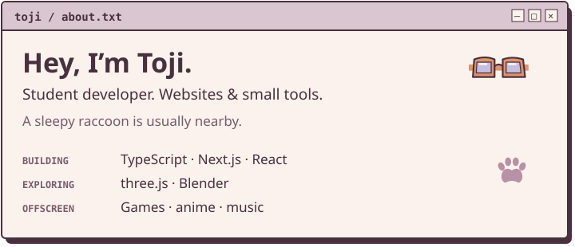
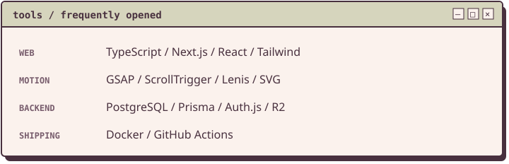
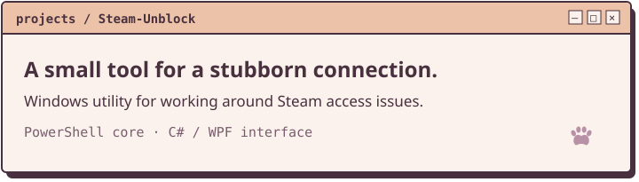
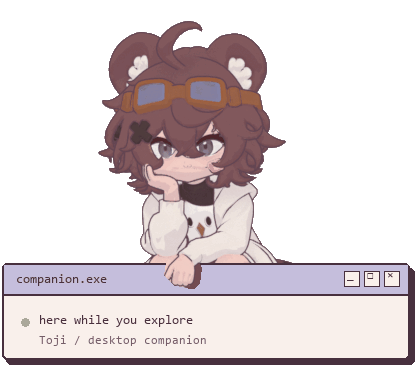
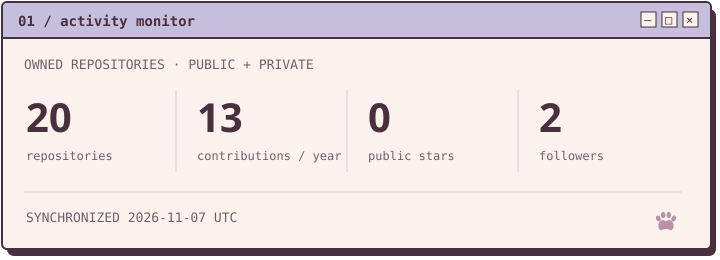
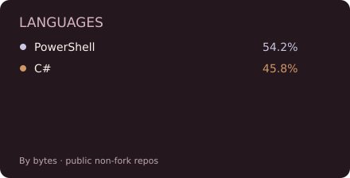
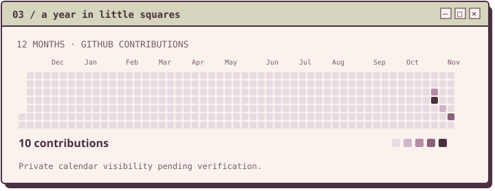

<picture><source media="(max-width: 600px)" srcset="assets/about-mobile.svg" /></picture>

<picture><source media="(max-width: 600px)" srcset="assets/toolkit-mobile.svg" /></picture>

[<picture><source media="(max-width: 600px)" srcset="assets/project-mobile.svg" /></picture>](https://github.com/Toji-ue/Steam-Unblock)

[Source code ↗](https://github.com/Toji-ue/Steam-Unblock) · [Releases ↗](https://github.com/Toji-ue/Steam-Unblock/releases)

<picture><source media="(max-width: 600px)" srcset="assets/stats-mobile.svg" /></picture>

<picture><source media="(max-width: 600px)" srcset="assets/languages-mobile.svg" /></picture>

<picture><source media="(max-width: 600px)" srcset="assets/activity-mobile.svg" /></picture>

Repository totals and languages include private projects, without revealing project details. Languages describe repository contents, not proficiency. Contributions follow GitHub's counting rules. Last successful refresh is shown on the card.

[View a still version of the mascot](assets/desktop-companion.png)

---

**Have a small web project in mind?** I'm open to freelance work.

[Portfolio & freelance enquiries → toji.moe](https://toji.moe)
